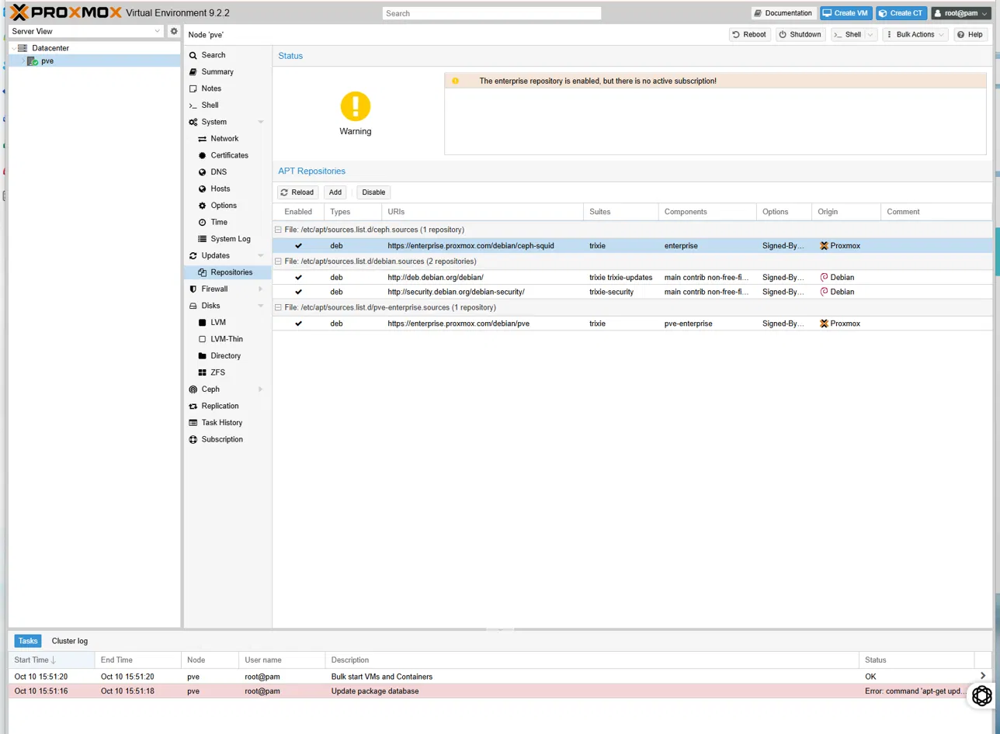
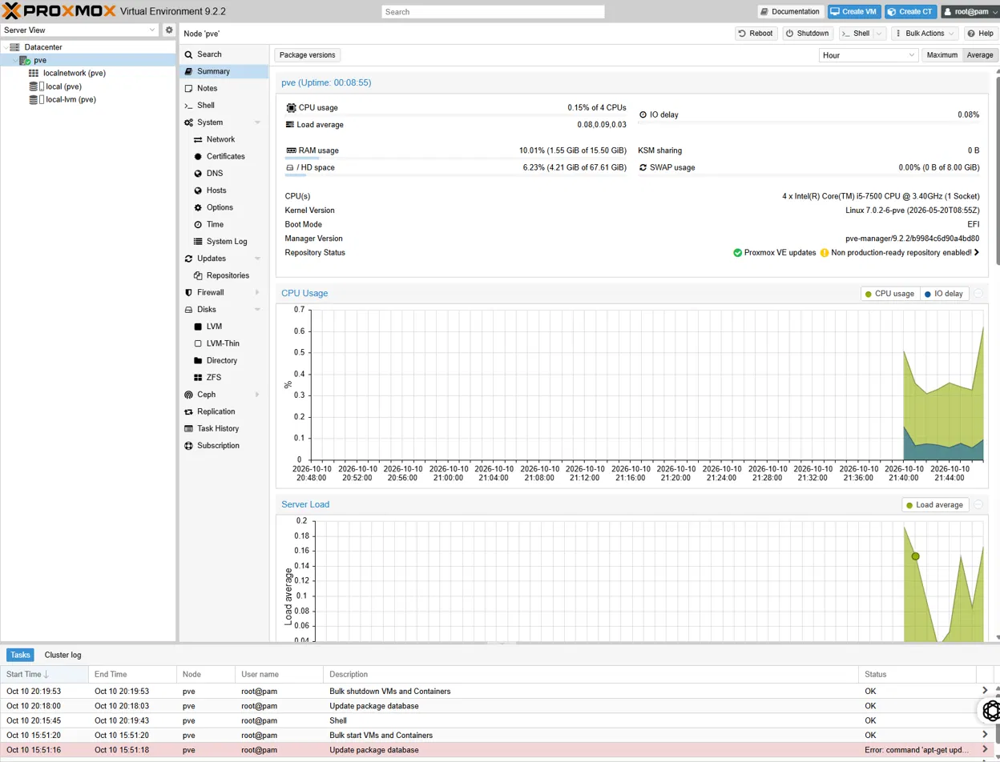
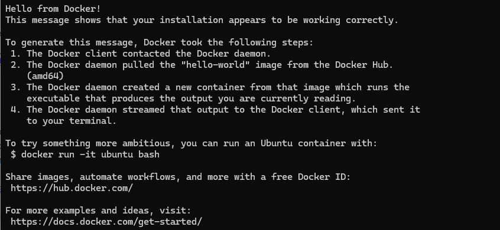
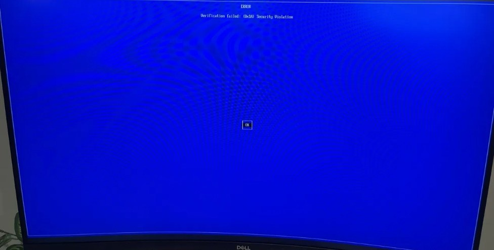
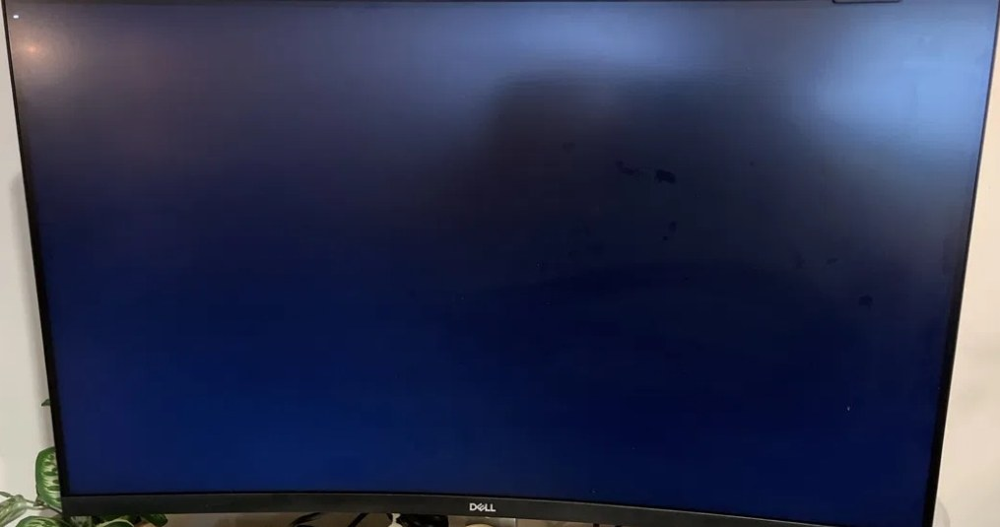
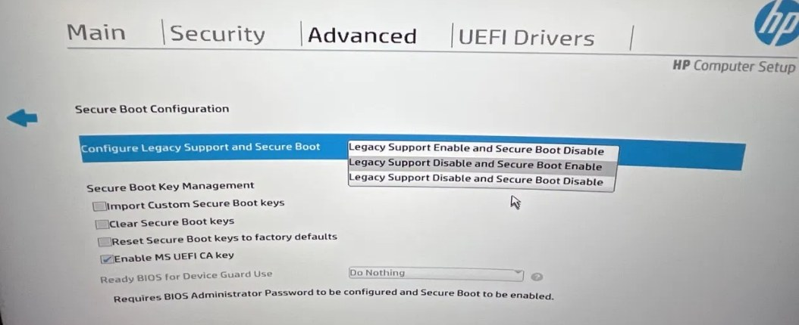

# Phase 1: Foundation

I turned an old office desktop into a server. It now runs Proxmox VE, and inside it there is a Debian virtual machine running Docker.

I had never touched Proxmox before this. It took two days, seven things went wrong, and one of them was a cable. All of it is below.

## What I built

- A Proxmox VE 9 host on an HP EliteDesk 800 G3 SFF, managed from a browser.
- A Debian 13 virtual machine dedicated to Docker, with Docker Engine and Docker Compose.
- A test container that proved the whole stack works end to end.
- This repository.

## Why I made these choices

I don't like following steps I can't explain, so I asked "why" at each one. These are the answers that stuck.

**Why a hypervisor.** I want one physical box to be a firewall, a NAS, a media server, and a security lab. A hypervisor lets each of those run as its own virtual machine with its own share of CPU, memory, and disk. Think of the server as a building and each virtual machine as a separate apartment. If I wreck one, the neighbors don't notice.

**Why Proxmox VE.** It's free, nothing is locked behind a license, and it has snapshots. A snapshot saves the exact state of a machine so I can try something risky and go back in seconds if it goes badly. For someone learning by breaking things, that matters a lot.

**Why Docker inside a VM and not straight on the server.** Isolation. If a container or a bad config breaks something, it breaks inside that one VM. The server and everything else keep running.

**Why Debian for the Docker VM.** It's light and stable, and Proxmox is built on Debian, so what I learn in one applies to the other.

## Hardware

| Component | Detail |
|---|---|
| Model | HP EliteDesk 800 G3 SFF |
| CPU | Intel Core i5-7500, 4 cores |
| RAM | 16GB DDR4 (2 x 8GB, two slots free) |
| Boot disk | 256GB NVMe SSD |
| Network | One onboard gigabit port |

## Steps

### 1. Installer USB

Downloaded the Proxmox VE ISO, checked its SHA256 hash against the value on the download page, and wrote it to a USB stick with Rufus. Rufus detects the image type and writes it in DD mode, which is what Proxmox needs.

### 2. BIOS settings

| Setting | Value | Reason |
|---|---|---|
| Virtualization Technology (VTx) | Enabled | Required to run virtual machines at usable speed |
| Virtualization Technology for Directed I/O (VTd) | Enabled | Lets a VM use a physical device directly. Needed later to give the integrated GPU to the media server |
| After Power Loss | Power On | The server will run without a monitor or keyboard, so it has to come back on its own after an outage |
| Storage controller RAID and Optane options | Left off | Those modes can hide the disks from the Proxmox installer |
| Secure Boot | Disabled | See "What broke" below |

### 3. Proxmox install

Installed to the internal NVMe with the default ext4 layout. Gave the host a static address on the home network and the hostname `pve.home.arpa`. The `home.arpa` domain is reserved for home networks, so it can't collide with a real internet domain.

### 4. Repositories and updates

A fresh install points at the enterprise repositories, which need a paid subscription and fail without one. In the web UI under Updates > Repositories, I disabled both enterprise entries and added the no-subscription repository. Then I refreshed and ran a full upgrade.


*A fresh install warns that the enterprise repository has no subscription.*


*The host after the upgrade and reboot, running the new kernel.*

### 5. Docker VM

| Setting | Value | Reason |
|---|---|---|
| Machine type | q35 | Modern virtual chipset, needed for GPU passthrough later |
| BIOS | OVMF (UEFI) | Same reason |
| QEMU guest agent | Enabled | Lets Proxmox shut the VM down cleanly and read its address |
| CPU | 2 cores, type host | The VM sees the real CPU features |
| Memory | 4GB | Leaves room for the firewall, NAS, and lab VMs |
| Disk | 32GB, SCSI, Discard on | Fast virtual disk type for Linux, and freed space is returned to the host |
| Network | VirtIO on the default bridge | Fastest virtual network card for Linux |

Debian was installed from the netinst image with no desktop environment, only the SSH server and standard utilities. I left the root account without a password, which disables it and gives my own user administrator rights through `sudo`.

Docker came from Docker's official apt repository, not from the Debian archive, to get a current version:

```bash
sudo apt update
sudo apt install -y ca-certificates curl qemu-guest-agent

sudo install -m 0755 -d /etc/apt/keyrings
sudo curl -fsSL https://download.docker.com/linux/debian/gpg -o /etc/apt/keyrings/docker.asc
sudo chmod a+r /etc/apt/keyrings/docker.asc
echo "deb [arch=$(dpkg --print-architecture) signed-by=/etc/apt/keyrings/docker.asc] https://download.docker.com/linux/debian $(. /etc/os-release && echo "$VERSION_CODENAME") stable" | sudo tee /etc/apt/sources.list.d/docker.list > /dev/null

sudo apt update
sudo apt install -y docker-ce docker-ce-cli containerd.io docker-buildx-plugin docker-compose-plugin

sudo usermod -aG docker $USER
```

After logging out and back in:

```bash
docker run hello-world
docker compose version
```

Seeing "Hello from Docker!" on the screen was the moment it felt real.


*The test container running inside the Debian VM.*

### 6. Housekeeping

- Took a snapshot of the VM in its clean state.
- Set the VM to start when the host boots.
- Changed the VM from DHCP to a static address in `/etc/network/interfaces`, so services always live at the same place.
- Set the DNS server for the VM by hand, because a static address no longer gets one from the router.

## What broke

This is the part I'd want to read if I were starting out, so I'm not skipping any of it.

**The BIOS key did nothing.** I pressed F10 at power on and the machine ignored me and booted the old operating system. The trick was to tap Esc over and over from the second I hit the power button. That brings up a startup menu, and F10 works from there.

**I couldn't log in to my own server.** I typed my email address as the username, because that's what I had entered during the install. The email is only for notifications. The user is `root`. Thirty seconds of confusion, fixed by reading the screen more carefully.

**The server refused to boot after its first update.** A blue screen that said "Verification failed: (0x1A) Security Violation". Nothing was lost. Secure Boot was rejecting the boot files the update had just installed. I didn't confirm the exact root cause. The firmware on this machine is from 2017, and its Secure Boot data is the likely reason. The fix was to turn Secure Boot off.


*What the server showed after its first update.*

**Then the fix wouldn't stick.** This was the hard one. I changed the setting, saved, rebooted, and got the same blue screen with the setting back where it started. I did it again. Same result. It turns out HP firmware asks you to type a confirmation code on the next boot before it accepts a Secure Boot change, and my monitor was showing that question as a blank dark screen. I was pressing Enter on a prompt I couldn't see, which cancelled the change every time. I swapped the DisplayPort cable for an HDMI to DisplayPort one, the prompt appeared, I typed the code, and it worked. Years in IT, and a cable still got me.


*The confirmation prompt as my monitor displayed it over the first cable. The firmware was waiting for a code here.*


*The setting that fixed it: Legacy Support Disable and Secure Boot Disable.*

**The installer download failed.** Two reasons. I had copied the arm64 link and my server needs amd64, and the first attempt timed out over a slow network link. The right link worked on the second try.

**Docker said "permission denied".** I ran `docker run` right after adding my user to the `docker` group. Linux only reads your group membership when you log in, so the change didn't count until I logged out and came back.

**I mangled a config file.** While editing the network settings, a few stray keystrokes damaged a line. I caught it before saving, exited without saving, and made the change with a single `sed` command, then checked the file before rebooting. I had a backup copy of the file and a snapshot of the VM, so the worst case was a rollback. That was the moment the snapshot stopped being an abstract idea.

**The VM lost DNS and my test didn't catch it.** After I gave the VM a static address, it could no longer look up internet names. With DHCP the router had been handing out the DNS server along with the address, and my static settings only covered the address and the gateway. I missed it at first because I tested with `docker run hello-world`, and Docker reused the image it had already downloaded. A failed `ping` to a hostname gave it away. `/etc/resolv.conf` had no `nameserver` line. On this system that file is rewritten by dhcpcd, so I put the DNS server in `/etc/resolv.conf.head`, which dhcpcd copies in every time. Then I tested with `docker pull alpine`, an image the VM had never downloaded, so the result could not come from a cache.

## What I learned

**Snapshots and backups solve different problems.** A snapshot is stored on the same disk as the virtual machine. It lets me undo a bad change in seconds, but it does nothing if the drive fails. Recovering from a hardware failure needs a full copy on separate storage, which is the focus of Phase 2.

**Confirm the current state before troubleshooting the fix.** When Secure Boot kept turning itself back on, I assumed I had picked the wrong setting. The setting was right. The firmware was holding the change until a person at the machine confirmed it, a safeguard that stops software from changing boot security on its own. I now check what state the system is really in first, and only then ask why it differs from what I expected.

**Secure Boot is a chain of trust, and firmware age is part of it.** Each stage of the boot process verifies the signature of the next one. An update can install boot files that older firmware does not trust, and the machine will refuse to start. Turning Secure Boot off was an acceptable trade-off for an isolated home lab. On a production system the better fix is to update the firmware and keep Secure Boot on.

**Verify what you download.** I checked the SHA256 hash of the installer before writing it to the USB. That confirms the file is complete and is the one the vendor published. Architecture matters as well: amd64 is the standard name for 64 bit Intel and AMD processors, and an arm64 image will not boot on this hardware.

**A passing test only proves what it tested.** The hello-world container ran fine while DNS was broken, because nothing in that test needed the network a second time. When I verify a change now, I pick a check that has to use the thing I changed.

**Least privilege starts at install time.** I disabled the root account on the Debian VM and work through `sudo`, so every administrative action is tied to a named user. I also learned that membership in the `docker` group is equivalent to root access on that machine, so it should only go to accounts that need it.

**Knowing the reason for each setting made the troubleshooting faster.** Because I understood why VTd, the q35 machine type, and the repository change were there, I could rule them out quickly when something failed and focus on what had changed.

## Next

Phase 2: install a NAS drive, create shares, move about 1.4TB of data off two external drives, and set up a scheduled backup that I prove works by restoring a file.
